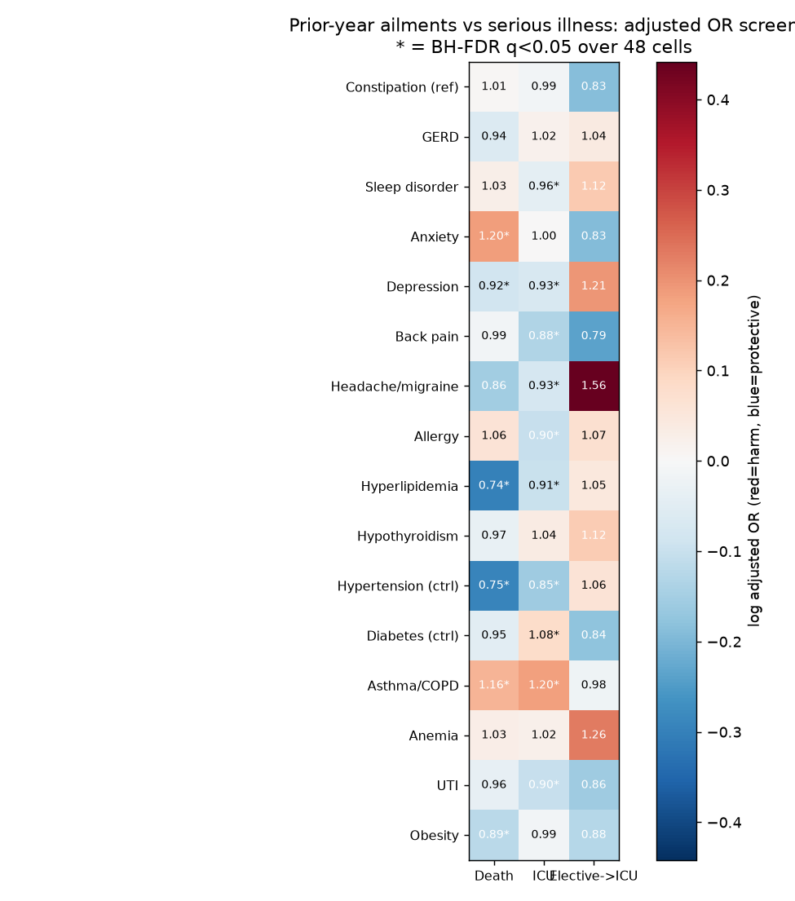

# Prior-year common ailments vs serious illness

Same rigor as the constipation study, widened to a screen: 16 common,
innocent-seeming prior-year ailments, each tested against three serious
outcomes. Structured fields only, 546,028 admissions.

## Design

- Exposure window [admittime - 365d, admittime): coded dx (ICD-9/10
  prefixes in prior admissions) OR drug-class Rx fills (generic-stem
  formulary match on `prescriptions`, with nystatin/aripiprazole/
  spironolactone excluded from the statin/PPI/iron stems they
  collide with). Primary definition: either.
- Outcomes: (1) hospital death (11,801 events), (2) any ICU stay during
  the hospitalization (85,242), (3) elective admission -> ICU transfer
  starting >=24h after admission ("unexpected ICU", 950 / 13,130
  elective admissions — planned post-op and direct ICU excluded).
- Covariates (same set for all 48 cells): age, sex, race, insurance,
  admission type/location, prior-admission count, prior total LOS,
  prior-year admission count, prior Charlson, 9 prior-comorbidity flags,
  admission year group. Utilization counts come from a join without
  diagnosis fan-out.
- Stage 1 (all 48 cells): crude ORs (dx / Rx / either) + adjusted
  logistic + E-value + BH-FDR over all cells.
- Stage 2 (FDR q<0.05 AND >10% effect only): adjusted dx/Rx
  decomposition, 1:1 propensity matching (full-caliper search) +
  balance, dose-response (Rx fills 0/1/2+, coded-only), recency
  since LATEST exposure (none / 6-12 mo / 0-6 mo).

Caveat: the uniform covariate set includes prior-comorbidity flags that
are downstream of some ailments (e.g. cardiac/renal disease for
hypertension). For those, the adjusted estimate is closer to a direct
than a total effect and can land paradoxically protective — read stage-2
matching and crude rates alongside.

## Screen (adjusted ORs, * = q<0.05)



## Results


Full numbers: `ail_screen.csv`. Forest plots: `forest_death.png`,
`forest_icu.png`, `forest_unexpected_icu.png`. Balance: `ail_balance.csv`
(all stage-2 |SMD| <= 0.11). Reference check: death|constipation adj
OR 1.005, p=0.86 — replicates the standalone constipation study
exactly.

8 stage-2 hits (q<0.05 AND >10% effect):

Harm signals:

| cell | adj OR | matched OR | verdict |
|---|---|---|---|
| death / anxiety (benzos) | 1.20 | 1.14, dose 2+ 1.32, recent 1.28, dx null | robust |
| ICU / asthma-COPD (albuterol) | 1.20 | 1.08, dose 2+ 1.40, recent 1.23, dx null | robust, attenuated |
| death / asthma-COPD | 1.16 | 1.03, p=0.52 | NOT robust, matching kills it |

Protective hits (all matched-robust):

| cell | adj OR | matched OR |
|---|---|---|
| death / hypertension | 0.75 | 0.70 |
| death / hyperlipidemia | 0.74 | 0.72 |
| death / obesity | 0.89 | 0.77 |
| ICU / hypertension | 0.85 | 0.85 |
| ICU / back pain | 0.88 | 0.78 |

Below the 10% gate (q<0.05, no stage 2): ICU/hyperlipidemia 0.91,
ICU/UTI 0.90, ICU/allergy 0.90, ICU/depression 0.93, ICU/diabetes
1.09, death/depression 0.92.

Unexpected ICU is entirely null: no ailment reaches q<0.05 under
the >=24h late-transfer definition. The previous elective->ICU
hits (hyperlipidemia 1.23, UTI 0.57, back pain 0.68, anxiety 0.71)
were planned/direct-ICU associations, not unexpected transfers.

Nulls: sleep, hypothyroidism, GERD, headache, anemia (death 1.03,
n.s. after the spironolactone exclusion), diabetes->death,
UTI->death, constipation->death, back pain->death.

## Read

1. **Drugs carry the signal, labels don't.** In nearly every hit the
   dx-only estimate is null while the Rx component drives the result —
   in both directions (benzos/albuterol harm; statins/antihistamines/
   antibiotics protective). A diagnostic label without treatment marks
   mild or inactive disease; fills mark active disease and care
   engagement.
2. **Protectives are engagement/selection markers, not shields.** They
   survive matching with dose gradients (more fills -> lower odds),
   so they are real associations — of treated, monitored, previously-
   seen patients vs everyone else — not causal protection. ICU
   protectives additionally reflect case-mix: much ICU volume is
   planned post-surgical care in previously-well patients, while
   prior-contact patients are admitted through medical channels to
   the floor.
3. **The unexpected-transfer endpoint killed its own hits.** Every
   prior elective->ICU association vanished once planned and direct
   ICU admissions were excluded — a clean demonstration that the
   endpoint definition was doing the work, not the ailments.
4. **Matching discriminates.** death|asthma (adjusted 1.16) attenuates
   to 1.03 under matching while icu|asthma survives at 1.08 — same
   exposure, outcome-specific robustness, exactly the constipation
   lesson.
5. **E-values 1.6-1.7** on the harm signals: even the robust positives
   fall to unmeasured confounding of ~1.6x (frailty, severity). No
   causal claims.
6. **UTI splits by definition** (crude): coded UTI predicts ICU (1.09)
   while UTI-antibiotic Rx protects (0.88) — susceptibility/frailty
   marker vs treatment-engagement marker. Adjusted UTI (0.90) sits
   below the stage-2 gate.

## Reproduce

```sh
/srv/mimic-iv/.venv/bin/python /tmp/ailment_sweep.py  # ~55 min on s0
```

then `make_plots.py` on the fetched CSVs. Raw log:
`ailment_sweep.out`. Screen table: `ail_screen.csv`. Forest rows:
`ail_forest.csv`. Balance: `ail_balance.csv`.
