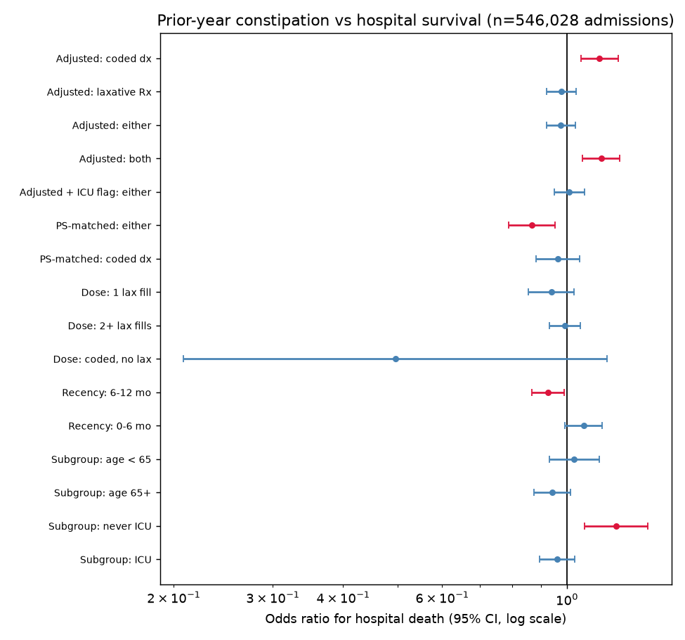

# Prior-year constipation vs hospital survival

Robust statistical analysis: does suffering from constipation in the year
before admission predict surviving the hospitalization? Structured fields
only (`diagnoses_icd`, `prescriptions`, prior-admission summaries), all
546,028 admissions, 11,801 hospital deaths (2.16%).

## Exposure (window: [admittime - 365d, admittime))

| definition | rule | prevalence | crude death rate |
|---|---|---|---|
| coded | ICD 564.0x / K59.0x in prior admissions | 5.55% | 3.29% vs 2.10%, OR 1.59 |
| lax_any | >= 1 laxative Rx fill (formulary match) | 33.49% | 2.60% vs 1.94%, OR 1.35 |
| either | coded OR lax_any | 33.59% | 2.59% vs 1.94%, OR 1.34 |
| both | coded AND lax_any | 5.44% | 3.33% vs 2.09%, OR 1.61 |

Covariates: age, sex, race, admission type/location, prior-admission count,
prior total LOS, prior-year admission count, prior Charlson (from ICD),
prior-year procedure burden, prior-year prescription count, current dx/procedure
counts, admission dx group; second spec adds ICU-stay flag.

## Result: no robust association (negative study)

- Adjusted logistic: **coded OR 1.14 [1.06-1.23], both OR 1.15
  [1.07-1.24]**; laxative-only definitions null (~0.98).
- Propensity 1:1 matching (caliper 0.2 SD, same covariates):
  **matched-coded OR 0.96 [0.88-1.05], p=0.42, 30,151 pairs (99.6%
  matched), all |SMD| <= 0.12** — the adjusted signal fully attenuates.
- Matched-either is protective (OR 0.87 [0.79-0.95]) but that estimate
  lives on a 30%-matched overlap population and disagrees with both the
  adjusted model and the coded match — not a robust claim either.
- Dose-response: flat (1 fill 0.94, 2+ fills 0.99, both null).
- Recency: no gradient (remote 0.92, recent 1.07, borderline/null).
- Subgroups: age split null; never-ICU OR 1.22 [1.07-1.39] but this is
  adjusted-only and subject to the same residual confounding the matching
  exposes.
- E-values 1.54-1.74: weak unmeasured confounding (frailty, severity not
  captured by prior-admission summaries) explains away the adjusted ORs.

Read: coded constipation marks sicker patients (crude +59%), and a +14%
adjusted residue survives a rich covariate set — but it does not survive
propensity matching, has no dose or recency gradient, and needs only a
1.5x unmeasured confounder to vanish. **Not a survival predictor.**



## Reproduce

Run `constipation.py` on s0 (needs the MIMIC-IV v3.1 sqlite db +
`duckdb, pandas, scikit-learn, statsmodels, scipy` in the venv):

```sh
/srv/mimic-iv/.venv/bin/python /tmp/constipation.py  # ~8 min
```

then `make_plots.py` (matplotlib) on the fetched `const_forest.csv`.
Raw log: `constipation.out`. Balance diagnostics: `const_balance.csv`.
