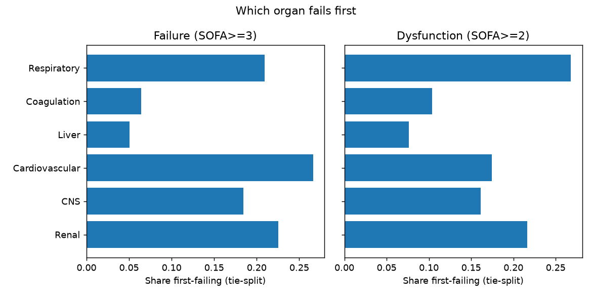
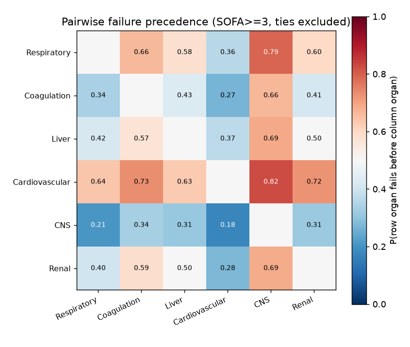
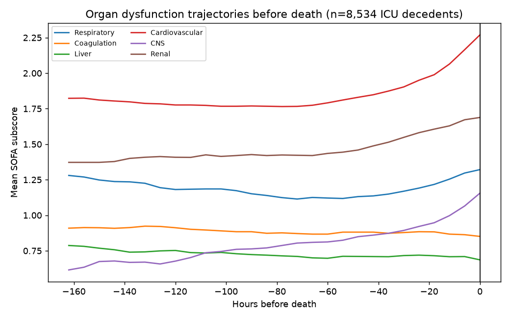
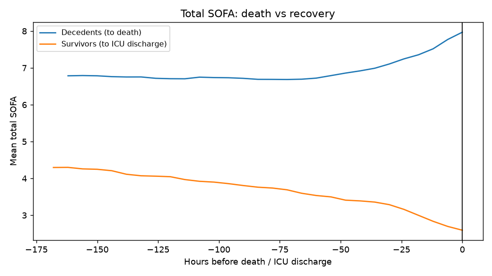
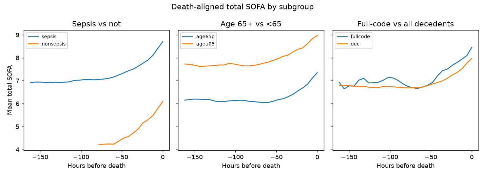

# In what order do organs fail before death

Terminal ICU stays of 8,534 hospital decedents (deathtime known,
death within 72h of ICU discharge); primary cohort ICU LOS >= 48h
(n=5,172, 83% septic). Prevalence, first-organ, precedence and
sequences all use the primary cohort. Organ failure = SOFA subscore
(trailing-24h, hourly) first reaching >= 3, sensitivity >= 2. Onsets
within 24h count as simultaneous (window blur). Structured fields
only, aggregates only.

## What fails, and first

Failure prevalence in the last 24h before death (>= 3, n=4,728 stays
with final-day SOFA data): cardiovascular 47%, renal 45%, CNS 37%,
respiratory 33%, coagulation 17%, liver 15%. Median 2 organs failed;
15% die with none >= 3.

First-failing organ (tie-split):



- Frank failure (>= 3): cardiovascular 27%, renal 23%, respiratory
  21%, CNS 18%, coagulation 6%, liver 5%.
- Dysfunction (>= 2): respiratory leads at 27%, then renal 22%, CV 17%.

## Pairwise order



Full table: `of_precedence_thr3.csv` (n, P-each-first, tie rate,
tie-excluded P-each-first, median lead). The heatmap shows
tie-excluded probabilities: respiratory-CV fail together 68% of the
time (intubation + pressors at the same crisis); among untied pairs
CV precedes CNS 82% and renal 72%; respiratory precedes CNS 79%;
renal precedes CNS 69%; liver-renal is a coin flip (50/50%).

Sequences are highly dispersed: 901 distinct orders among 3,938 stays
with >= 2 failures. No single cascade dominates; the top 20 are all
CV/renal/respiratory combinations with CNS last
(`of_sequences_thr3.csv`). Median first failure -> death: 127h;
second 117h; third 102h.

## Trajectories



CV runs highest throughout and rises into death; renal second; CNS
rises late; coagulation/liver flat. Total SOFA drifts 5.1 -> 8.0 over
the last week — gradual, no terminal cliff.



Decedents diverge from survivors (15k sample, aligned to ICU
discharge): survivors fall toward discharge, decedents grind upward.



Subgroups (sepsis/non, 65+/-, full-code/all) share the same shape;
early-DNR stays are 45% of decedents and look no different in total
SOFA, against a pure withdrawal-driven terminal spike. Strict
full-code (code status charted, never DNR/CMO) is only 573 decedents
(7%); 601 have no code-status rows at all.

## Validation

- Vasopressors start median +0h after CV>=3 (circular by
  construction — CV score is pressor-defined — but confirms
  alignment); RRT +17h after renal>=3; invasive ventilation -3h
  before respiratory>=3 (intubation precedes the worst gas window).
- CNS caveat: GCS under sedation inflates CNS scores in ventilated
  patients, so CNS "failure" partly measures sedation depth.

## Literature correspondence

1. **"Lungs first" (Border/Baue; MODS reviews: pulmonary precedes
   cardiac/renal/hepatic) — partly upheld, refined.** Holds for
   dysfunction onset (>= 2: respiratory first at 27%). Fails for frank
   failure (>= 3: cardiovascular first at 27%, and respiratory-CV
   are simultaneous 68% of the time). Teaching update: respiratory
   dysfunction is the earliest warning; cardiovascular collapse is
   the most common first frank failure and usually arrives with
   respiratory failure, not after it.
2. **Vincent et al. 2011 ("Is worsening MOF the cause of death in
   severe sepsis?") — weaker than first reported.** With stale
   discharge rows excluded (fresh SOFA required near both cutoffs),
   mean dSOFA(-96h -> -24h) = +0.35 (n=3,384): increased 45.3%,
   stable 15.6%, decreased 39.0%. The earlier 32% "stable" was
   inflated by reusing one stale discharge score at both cutoffs;
   the honest split is increased-vs-decreased with little exact
   stability. Mean change is still a small increase, but "persistent,
   not worsening" no longer describes the distribution.
3. **INDEPTH (80% with >= 1 organ increase in last 4 days) —
   closer after the freshness fix: 70%.** Remaining gap plausibly
   from our -24h cutoff, which excludes the agonal day where most
   change concentrates; INDEPTH's window reaches death itself.
4. **Gupta et al. (sepsis SOFA-component mortality ranking: coag >
   hepatic > resp > neuro > renal > CV) — top agrees, rest
   diverges.** Our lethality P(death | ever >= 3): liver 40% > coag
   37% > CNS 31% > CV 30% > renal 29% > respiratory 27% (baseline
   12%). Both rank coagulation/hepatic failure most ominous (rare
   but lethal — unfixable systemic collapse). Respiratory is #3 in
   Gupta but last here: common and salvageable (ventilation works),
   and Gupta's per-point adjusted ORs answer a different question
   than crude ever-failed lethality.

## Reproduce

```sh
/srv/mimic-iv/.venv/bin/python /tmp/organ_failure.py  # ~10 min on s0
```

then `make_plots.py`. Raw log: `organ_failure.out`.
