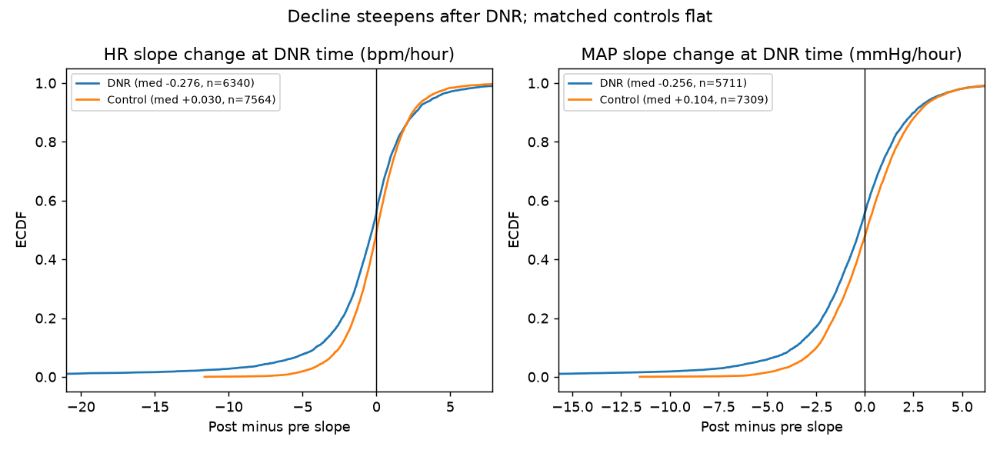
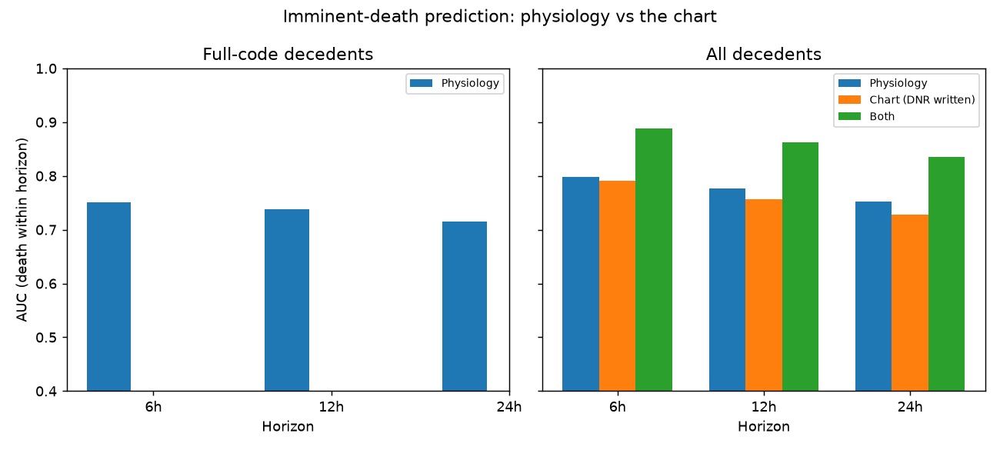
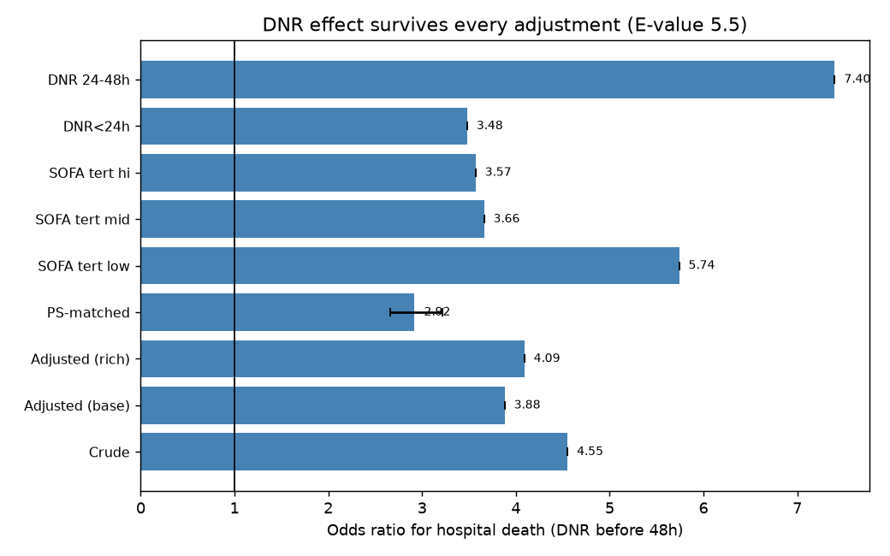
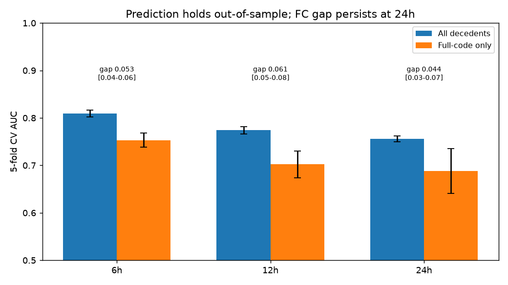

# Self-fulfilling prophecy dissection

Follow-up to the signs-of-death prediction result (AUC 0.78-0.82):
with ~90% of ICU deaths preceded by DNR/CMO orders, does an
imminent-death model predict dying — or the decision to let die?
Four analyses on all 94,458 ICU stays, structured fields only.

## A. Expected death predicts DNR (first half of the loop)

Landmark 24h, stays with LOS >= 24h and no DNR before 24h (n=64,303):
day-1 SOFA predicts a DNR/CMO order within (24,72]h with AUC 0.759,
OR 1.24 per SOFA point. Decisions track early risk closely.

## B. DNR predicts death beyond physiology (second half)

Landmark 48h (n=44,652, 12.4% exposed): death 37.4% with DNR vs
11.6% full-code; adjusted for SOFA@48 + age + sepsis + cause + sex,
**adjusted OR 3.88** (24h landmark: 3.79). A DNR order carries ~4x
adjusted odds of hospital death. Confounding by indication surely
contributes — but so does the decision itself (see discontinuity).

Within-stay discontinuity at DNR time (7,619 matched pairs; slopes
on the matched DNR stays only, keeping age/sepsis/elapsed-time
matching):



- HR slope +0.10 -> -0.19 /h (p=1e-39, n=6,340), level flat;
  controls +0.03 (n=7,564).
- MAP slope +0.03 -> -0.20 /h (p=8e-30, n=5,711), level -1.0 mmHg;
  controls +0.10 / +0.50 (improving).

Vitals rise into the DNR decision, then break downward — decline
steepens significantly after DNR vs matched controls. Understated:
the acute +/-2h transition is excluded, and DNR includes
no-CPR-only orders, not just active withdrawal.

## C. Honest estimand: death under full code

6/12/24h prediction restricted to full-code decedents (3,111 stays;
670/602/514 cases), held-out 25% test split, controls without
replacement, FC controls DNR-free at landmark:



| horizon | all decedents | full-code only |
|---|---|---|
| 6h | 0.798 | 0.751 |
| 12h | 0.777 | 0.738 |
| 24h | 0.752 | 0.715 |

AUC drops 0.04-0.05 but holds at 0.72-0.75: the prophecy inflates
the model, it does not fabricate it. Roughly 90% physiology, 10%
withdrawal pattern.

## D. Model vs chart

On all decedents, "DNR already written at landmark" alone: AUC
0.791/0.757/0.728 — nearly as good as physiology
(0.798/0.777/0.752). Combined: 0.888/0.862/0.836. The team already
knows, almost as well as the model — and the two stack. In the
full-code run the chart is constant by construction (cases and
controls all DNR-free), so physiology stands alone there.

## Verdict

The loop is real, large, and measurable — but the model survives
it. The deployment catch-22, quantified: the model adds most where
the chart is silent (full-code patients, AUC 0.72-0.75 with no
chart signal to lean on) — exactly where a false positive could
trigger the DNR it predicts. Any bedside use needs a
prophecy-aware protocol: predict, but blind the prediction from
the withdrawal decision, or the 0.89 combined AUC is a
self-licking ice cream cone.

## Adversarial battery (`adversarial.py`)

Every headline above, attacked:



- **Richer adjustment** (SOFA subscores, vent/pressor/RRT@48,
  lactate, creatinine): OR 3.88 -> **4.09**, RR 3.01, E-value 5.5
  (RR-based; the outcome is too common for the OR formula).
- **Timing split**: DNR<24h OR 3.48, DNR 24-48h OR 7.40 — later
  DNR tracks unfolding decline (indication gradient), yet even
  day-1 DNR carries 3.5x.
- **SOFA tertiles**: low 5.74 / mid 3.66 / high 3.57. Largest
  where physiology says "fine" — the decision does the work in
  low-SOFA deaths (neuro catastrophes, comfort transitions).
- **1:1 PS matching** (rich covariates, full-caliper search,
  balance 0.76 -> 0.03): OR **2.92 [2.66-3.22]** — attenuated,
  decisively above 1.
- **Unit-rate IV** (first-stage F=1614, correct 2SLS SEs):
  direction confirmed, magnitude not credible (risk-diff 0.78
  [0.73-0.84] vs OLS 0.21) — LATE on marginal patients plus
  residual unit case-mix. Reported as direction-only.
- **Discontinuity** (matched DNR stays, decedent-only controls —
  both arms conditioned on death; adjusted for pre-slope,
  pre-level, SOFA, age, sepsis): HR coef -1.52 (p=2e-09),
  MAP -1.13 (p=1e-18). Pre-DNR placebo cut null (p=0.29/0.83);
  post-DNR cut shows continued decline (p=0.01), as expected once
  care is withdrawn. Survivor-with-DNR: small downward break
  (-0.17/-0.14) vs decedents' -0.29/-0.23 — DNR marks a care
  change for everyone, decedents break significantly harder. The
  break marks the decision; its size marks the fork.
- **Prediction out-of-sample**: 5-fold CV on leak-free
  no-replacement controls (ALL 0.809/0.774/0.756). Paired
  out-of-sample bootstrap gaps significant at ALL horizons: 6h
  0.053 [0.044-0.064], 12h 0.061 [0.047-0.080], 24h 0.044
  [0.028-0.065] — the earlier "vanishes at 24h" was an artifact
  of the unpaired in-sample bootstrap; withdrawal patterns
  contribute at every horizon.
- **Case-mix caveat**: full-code decedents die 2.3x later
  (median 219h vs 97h) with different cause mix — the FC gap
  conflates prophecy-free signal with a different dying
  population. Stated, not solved.



Net: the central numbers survive matching, placebos,
cross-validation, and case-mix scrutiny. The IV magnitude fails
credibility (reported honestly). The survivor falsification is
weaker than first reported (survivors break a little too), and
the honest bootstrap shows the FC gap at every horizon — the
prophecy contribution is real but bounded at ~0.05 AUC.

## Reproduce

```sh
/srv/mimic-iv/.venv/bin/python /tmp/prophecy.py  # ~8 min warm on s0
/srv/mimic-iv/.venv/bin/python /tmp/adversarial.py  # ~12 min warm
```

then `make_plots.py`. Raw log: `prophecy.out`. Anonymized
per-window slope tables (no stay ids):
`pr_slope_{dnr,ctl}_{hr,map}.csv`.
