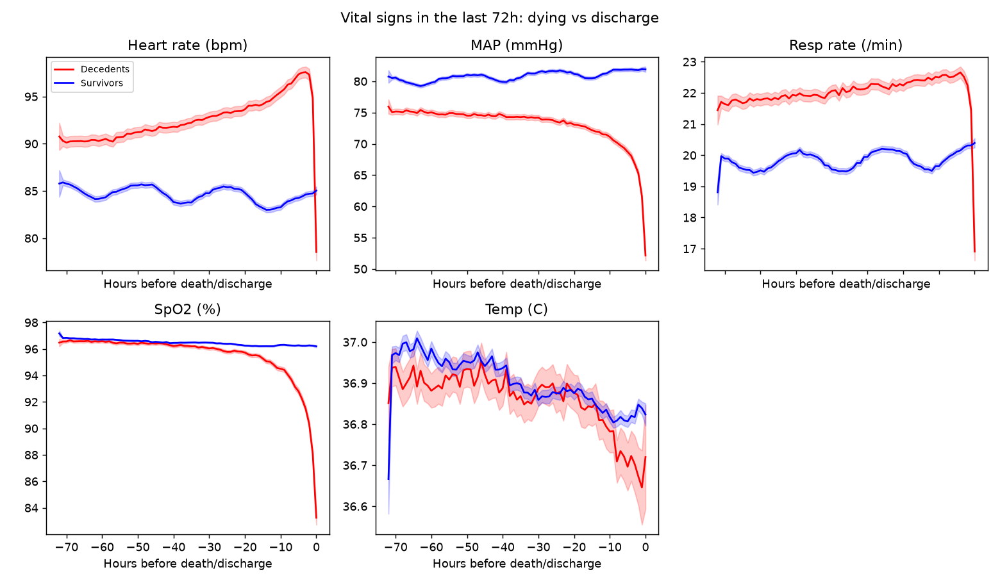
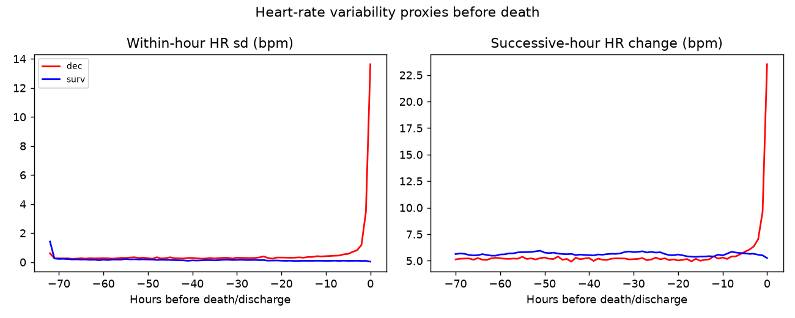
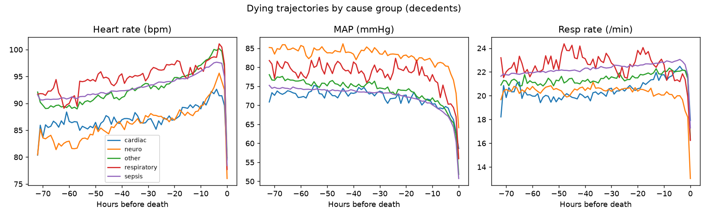
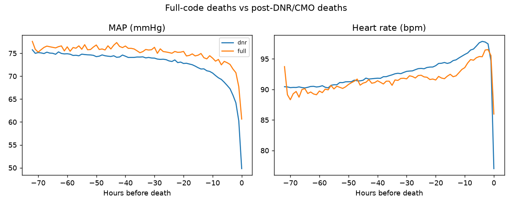
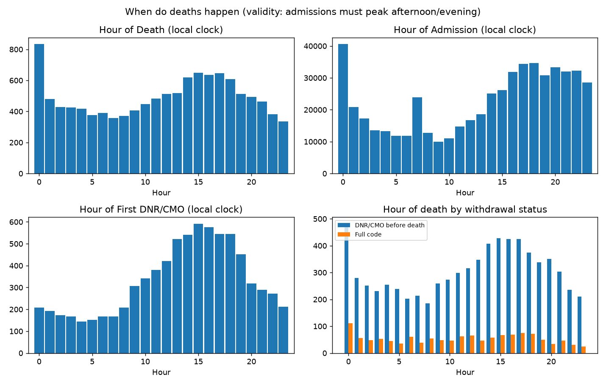
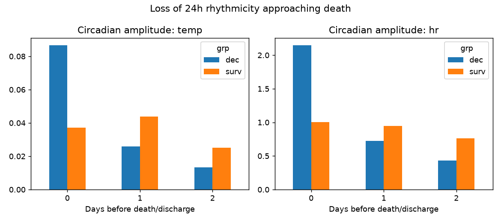
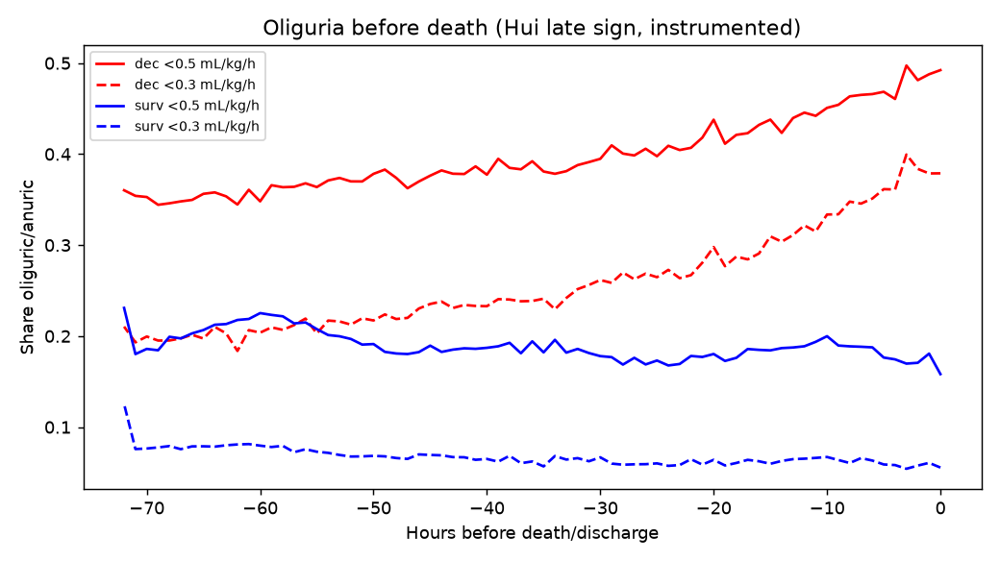

# Signs of death: literature gaps, tested at scale

Western literature on the signs of death is dominated by small
palliative-care cohorts with intermittent bedside observation (Hui et
al.: Cheyne-Stokes, pulselessness, death rattle, mandibular breathing,
oliguria — highly specific for death within 3 days in advanced
cancer; Kehl & Kowalkowski systematic review, n=2,416; clinician
72h prediction wrong 1 in 3; PaP AUC 0.82 at days-weeks scale).
This study tests the gaps that literature leaves open, on 9,438
terminal-ICU decedents (+15k survivor sample) with hourly physiology.

## Gap 1: continuous physiology of dying

Literature signs are intermittent observations. Hourly vitals over
72h (decedents vs survivors aligned to discharge):



- HR: decedents run +4 to +13 bpm above survivors, then crash
  through them in the last ~6h (gap -6.5 at death) — tachycardia
  into agonal bradycardia.
- MAP: below throughout, gap explodes -5.5 -> -29.8 mmHg.
- RR: above (+2-3), then below at death (-3.5) — terminal
  brady/apnea crossover.
- SpO2: no gap until ~-12h, then collapse (-13.0) — a pure
  terminal signal.
- Temperature: no gap at any hour — body temp does not
  discriminate dying in the ICU (vs temp-rise findings in cancer
  wards; setting difference).

## Gap 2: autonomic collapse beyond trauma HRV studies

Cardiac uncoupling (reduced HRV -> death, 2-4 day window) was shown
in 2,088 trauma patients with waveform data. At chart resolution it
does not replicate as collapse:



- Within-hour HR sd is confounded by monitoring intensity:
  crashing patients get q15min vitals (sd 13.6 at death),
  stable survivors hourly ones (sd ~0). It measures nursing
  attention, not autonomy.
- Successive-hour HR change shows terminal *instability*, not
  uncoupling: 23.5 vs 5.3 bpm at the last hour — agonal swings.

## Gap 3: cause-specific modes of dying

Literature treats dying as one process (or cancer-only). Split by
sepsis / cardiac / neuro / respiratory / other (primary dx):



- Sepsis is 68% of ICU decedents and dies late (median 125h, 34%
  within 72h — cf. Daviaud et al. 32% early deaths in septic
  shock); cardiac/neuro/respiratory die early (medians 28-45h,
  64-72% within 72h).
- First-organ failure by cause (`sd_cause_first.csv`): cardiac ->
  CV 44%, neuro -> CNS 61%, sepsis diffuse (CV 30 / resp 21 /
  renal 21), respiratory -> CNS 35% (CO2 narcosis/sedation, n=199).

## Gap 4: withdrawal vs natural dying, quantified

Prendergast: withholding/withdrawal precedes ~90% of ICU deaths.
Replicated exactly: DNR/CMO before death in 89.5%, median DNR ->
death 31h. But trajectories differ only in degree:



Last-6h slopes (per hour toward death): HR falls 2.4/h post-DNR vs
0.6/h full-code; MAP falls 2.9/h vs 2.0/h. Same shape, steeper
after limitations — the dying signature is not a withdrawal
artifact, though withdrawal steepens it.

## Gap 5: circadian timing + rhythmicity loss

Hospice lore says deaths cluster 02:00-05:00; hospital studies find
morning/afternoon peaks. MIMIC clock-times are mildly contaminated
(~3% midnight-stamped records) but the admission control shows the
expected afternoon/evening ED pattern, so shapes are interpretable:



- Deaths peak 14:00-17:00, trough at night (chi2=683, p~0) —
  hospice lore refuted for hospital deaths; literature peaks
  confirmed.
- DNR decisions peak the same afternoon hours — but the death peak
  is NOT withdrawal-driven: afternoon share 0.320 post-DNR vs
  0.294 full-code, same shape both groups.
- Detrended cosinor: no temperature rhythm in either group at any
  day (ICU obliterates it); HR rhythm ~0.7-1.0 bpm in survivors,
  lost 1-2 days before death (0.22 -> 0.10) — matching ward
  findings of HR amplitude loss 2 days out. Day-of-death HR is
  uninterpretable (agonal trend dominates).



## Gap 6: hour-scale imminent-death prediction

Clinicians are wrong 1 in 3 at 72h; PaP AUC 0.82 covers
days-weeks. Case-control logreg (6h vital windows, vitals + age +
sepsis; controls matched on elapsed ICU time):

| horizon | AUC | AUC w/o chart-count |
|---|---|---|
| 6h | 0.816 | 0.813 |
| 12h | 0.783 | 0.778 |
| 24h | 0.777 | 0.771 |

Top coefficients: MAP, HR, RR, SpO2, sepsis, age. Chart-count
(hr_n) carries a large coefficient but ablating it costs only
~0.005 AUC — the prediction is physiological, not a monitoring
artifact.

## Hui validation: oliguria, instrumented



Weight-normalized UO <0.5 mL/kg/h: decedents 36% -> 49% over 72h
vs survivors 16-23% flat. Hui's late sign validates directionally
but is poorly specific in the ICU (vs cancer wards) — a third of
decedents are already oliguric 3 days out.

## Reproduce

```sh
/srv/mimic-iv/.venv/bin/python /tmp/signs_of_death.py  # ~10 min warm
/srv/mimic-iv/.venv/bin/python /tmp/signs_followup.py  # withdrawal clock split
```

then `make_plots.py`. Raw log: `signs_of_death.out` (both runs).
CSVs: `sd_traj`, `sd_hrv`, `sd_death/admit/dnr_hour`,
`sd_death_hour_wd`, `sd_cos_{temp,hr}`, `sd_cause_{timing,hr,map,
rr,first}`, `sd_wd_{hr,map,rr,spo2,temp}`, `sd_oliguria`.
